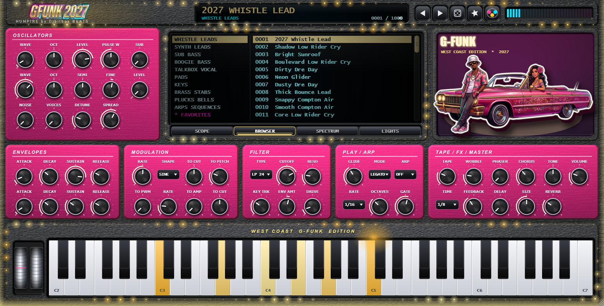

# GFUNK 2027 — Developer README

West Coast G-Funk synthesizer (VST3 / AU / Standalone) by **HUMPIRE by Djbilbox BEATS**, built with JUCE 8 and CMake.



## Layout
```
CMakeLists.txt            plug-in + offline render test (JUCE 8.0.4 fetched automatically)
Source/PluginProcessor.*  DSP: 8 voices, 2 osc + sub + noise, unison, ZDF SVF filter, 2 ADSR, 2 LFO,
                          arpeggiator, tape, phaser, chorus, ping-pong delay, reverb, funk-energy metering
Source/PluginEditor.*     UI: LED screen (scope / browser / spectrum / lights), lit keyboard, bling overlay, splash
Source/Generated/         GENERATED parameter table, UI layout and the 1000 presets (do not edit by hand)
Resources/                bg.jpg, knob.png, led_mask.png, logo.png, hero.jpg (generated artwork)
tools/                    Python generators (parameters, presets, artwork, loudness calibration)
Tests/RenderTest.cpp      renders all 1000 presets and checks for NaN / silence / clipping; UI snapshot mode
art_prompts/              Google Flow prompts for the hero poster, car, character, 3D logo
```

## Build (MSVC / Xcode / GCC)
```bash
cmake -B build -DCMAKE_BUILD_TYPE=Release
cmake --build build --config Release --parallel
```
Use a local JUCE with `-DJUCE_DIR=/path/to/JUCE`. Outputs: `build/GFUNK2027_artefacts/Release/{VST3,AU,Standalone}`.
macOS universal: add `-DCMAKE_OSX_ARCHITECTURES="arm64;x86_64"`. Disable the test target with `-DGFUNK_BUILD_TESTS=OFF`.

> The Windows binaries shipped in `Builds/Windows` were produced with LLVM-MinGW (statically linked) because the
> authoring PC had no Windows SDK. They start and render correctly in the standalone, but were **not validated in a
> DAW**. For release, build with Visual Studio and validate with Steinberg's validator or `pluginval`.

## Regenerating data and artwork
```bash
pip install numpy pillow
py tools/gen_code.py            # Source/Generated from tools/gfunk_spec.py + tools/gen_presets.py
py tools/gen_art_modern.py all  # logo, splash, LED mask (needs Windows fonts: Impact, Bahnschrift, Arial)
py tools/gen_skins.py all       # the six skins: Resources/bg_<n>.jpg + knob_<n>.png
py tools/make_cutout.py green.jpg   # Resources/hero_cutout.png from a green-screen illustration
```
Add a Google Flow poster as `Resources/hero_user.jpg` before running the art script to use it as the splash screen.

### Preset library
`tools/gen_presets.py` builds 10 categories × 100 presets from musically constrained templates, 10 "flavour"
modifiers and seeded randomness. After changing synth code, re-equalise loudness:
```bash
GFunkRenderTest <outDir> 0          # writes rms.csv
py tools/calibrate.py <outDir>/rms.csv && py tools/gen_code.py   # rebuild, repeat once or twice
```

## Tests
```bash
GFunkRenderTest                       # all 1000 presets: NaN / silence / clip / CPU
GFunkRenderTest snap shot.png 214     # editor screenshot of preset 214 with a chord playing
GFunkRenderTest outDir 0 150 500      # additionally writes WAVs of those presets
```
Last run: 1000 presets, 0 NaN, 0 silent, 0 clipped, RMS 0.11–0.27, about 50× real time.

## Windows installer
```bash
powershell -ExecutionPolicy Bypass -File installer/build_installer.ps1
```
Produces `GFUNK_2027_Setup.exe` (IExpress, no extra tools): installs the VST3 to `C:\Program Files\Common Files\VST3`,
the standalone app to `C:\Program Files\HUMPIRE\GFUNK 2027`, adds a Start-menu shortcut and an uninstall entry.
The installer is unsigned, so Windows SmartScreen shows an "unknown publisher" notice; sign it with a code-signing certificate for distribution.
