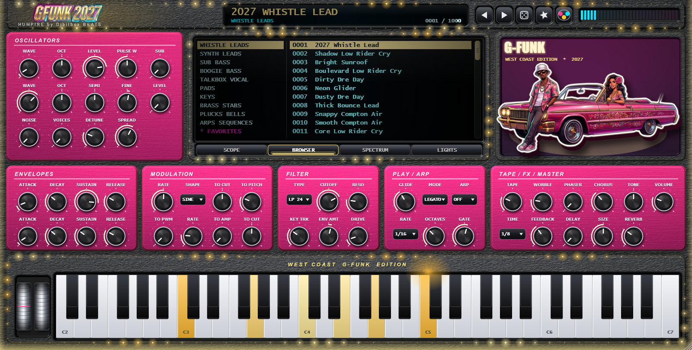
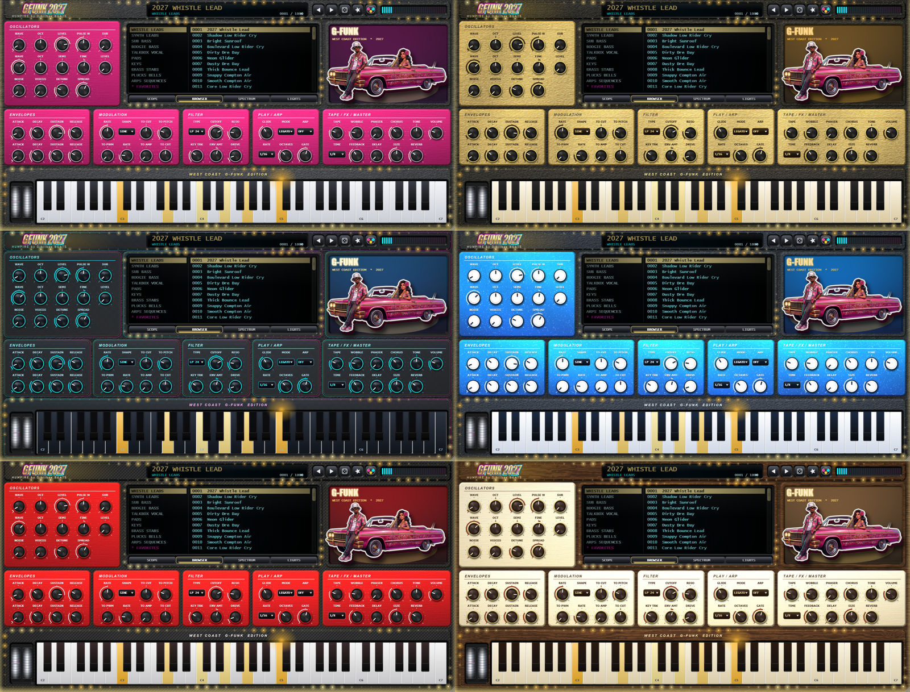

# GFUNK 2027 — User Guide

**HUMPIRE by Djbilbox BEATS** · West Coast G-Funk × Cyberpunk Synthwave

GFUNK 2027 is an 8-voice synthesizer built for whistle leads, sub-boogie basses, talkbox-style pads and
lowrider brass. It ships with **1000 factory presets**, a big LED screen with scope, preset browser and
spectrum, an arpeggiator, tape / phaser / chorus / delay / reverb, and a light show that reacts to how funky
you play.

Six complete interface skins are included (click the colour-dots button in the header, or use the LIGHTS tab):

---

## 1. System requirements

| | Windows | macOS |
|---|---|---|
| OS | Windows 10 / 11 (64-bit) | macOS 10.13 or later |
| CPU / RAM | Dual-core 2.0 GHz, 4 GB | Intel or Apple Silicon, 4 GB |
| Screen | 1280 × 720 or larger (window is resizable) | 1280 × 720 or larger |
| Formats | VST3, Standalone | AU, VST3, Standalone |

## 2. Installation

**Windows (VST3):** copy `GFUNK 2027.vst3` to `C:\Program Files\Common Files\VST3\`, rescan plug-ins in your
DAW and load GFUNK 2027 on an instrument / MIDI track.

**macOS:** copy `GFUNK 2027.component` to `~/Library/Audio/Plug-Ins/Components/` and `GFUNK 2027.vst3` to
`~/Library/Audio/Plug-Ins/VST3/`. If macOS blocks it, use *System Settings → Privacy & Security → Open Anyway*.
In Logic Pro run *Plug-In Manager → Reset & Rescan Selection*.

## 3. The interface

| Area | What it does |
|---|---|
| **Header** | Logo (click it to reopen the splash screen), preset display, ◀ ▶ previous / next preset, random preset, ★ favourite, the **skin button** (three colour dots) that cycles the six skins, output meter. |
| **Showcase panel** | The man, the woman and the Impala in thick 3D relief. They follow your mouse (parallax) and bounce on every note you play. |
| **LED screen** | Four tabs: **SCOPE** (oscilloscope with a magenta ghost trail), **BROWSER** (10 categories × 100 presets), **SPECTRUM** (48-band analyser), **LIGHTS** (light show settings). |
| **Oscillators** | Two oscillators with a continuous wave morph (sine → triangle → saw → square), sub oscillator, noise, pulse width and 1–7 voice unison with detune and stereo spread. |
| **Filter** | Multimode filter (LP 12, LP 24, band, high-pass), cutoff, resonance, key tracking, envelope amount, drive. |
| **Play / Arp** | Glide, voice mode (poly / mono / legato) and the arpeggiator (pattern, rate, octaves, gate). |
| **Envelopes** | Top row: amplitude ADSR. Bottom row: filter ADSR. |
| **Modulation** | LFO 1 (sine, triangle, saw, square, sample & hold) to cutoff, pitch and pulse width. LFO 2 to tremolo and cutoff. |
| **Tape / FX / Master** | Tape saturation, wobble (wow & flutter), phaser, chorus, tone tilt, tempo-synced ping-pong delay, reverb, master volume. |
| **Keyboard + wheels** | Click the keys to play. Left wheel = pitch bend (springs back), right wheel = mod wheel (adds vibrato). Keys light up when notes play, including notes from the arpeggiator. |

Hovering or turning any control shows its name and value in the preset display. Double-click a knob to reset it.

**Resizing:** drag the window corner (in the standalone app, or in hosts that allow resizing the plug-in window). The whole interface scales smoothly and keeps its proportions.

### The preset browser
Click a category on the left, then a preset on the right. Scroll with the mouse wheel or drag the wide scrollbar on the right of the list. If the wheel scrolls the wrong way on your mouse or touchpad, switch **SCROLL** between NORMAL and INVERTED in the LIGHTS tab. **Right-click a preset to
add or remove it from FAVORITES** (the last entry of the category list; the ★ button does the same for the
current preset). Favourites are stored in `%APPDATA%/HUMPIRE/GFUNK2027/favorites.txt` (macOS:
`~/Library/Application Support/HUMPIRE/GFUNK2027/`).

Categories: Whistle Leads · Synth Leads · Sub Bass · Boogie Bass · Talkbox Vocal · Pads · Keys · Brass Stabs ·
Plucks Bells · Arps Sequences. The first presets of several categories are the five signature sounds:
*2027 Whistle Lead*, *Nate West Coast Synth*, *Sub-Boogie Bass*, *Cyber Talkbox Pad*, *LA Lowrider Brass*.

### The light show
When you play, the synth measures how funky you are (note rate, velocity, glides, arps). The more you play, the
more the marquee bulbs chase, the keys glow, sparkles fly and the panels pulse on every hit. In the **LIGHTS**
tab choose the colours (GOLD, CANDY, NEON, ALL), the intensity (OFF, NORMAL, MAX) and the **SKIN**: Rose Plastic, Gold Vault, Neon Midnight, Candy Blue, Carbon Red or Walnut Cream. Settings are saved with
your project.

## 4. Voice behaviour
- **POLY**: 8 voices, oldest note is stolen first. **MONO**: one voice, retriggers on every note.
  **LEGATO**: one voice, overlapping notes glide without retriggering (the West Coast whistle).
- The sustain pedal (CC 64), pitch bend and mod wheel (CC 1) are supported.
- **ARP** (UP, DOWN, UP-DN, RANDOM) follows the host tempo; RATE sets the step length, OCTAVES the range,
  GATE the note length.

## 5. Sound design tips for G-Funk
**Whistle lead:** WAVE near 0.1–0.2, MODE LEGATO, GLIDE 150–220 ms, LFO 1 rate 5–6 Hz with TO PITCH 0.2–0.3,
a little TAPE and WOBBLE, REVERB 30 %. Overlap notes so the glide engages.

**Sub-boogie bass:** WAVE 0.5, SUB 70–90 %, CUTOFF 300–500 Hz, ENV AMT 50 %+, short DECAY, TAPE 40–60 %.

**Talkbox / vocal pad:** TYPE BAND or LP 24, RESO 50–60 %, LFO 1 at 0.3–0.5 Hz with TO CUT 40 %, slow attack,
wide CHORUS and REVERB.

**Brass:** fast attack, ENV AMT 60–80 %, UNISON 2–3 with small DETUNE, LEGATO or POLY.

**Arps:** pick an ARPS preset, hold a chord, then play with RATE, GATE and the DELAY mix.

## 6. Troubleshooting
- **No sound:** the track must send MIDI to the plug-in; check VOLUME and SUSTAIN.
- **Clicks on note start:** raise ATTACK above 2 ms.
- **High CPU:** set LIGHTS to OFF, lower the UNISON voices, increase the audio buffer.
- **Plug-in not listed:** check the install folder and rescan.

## 7. Credits & links
Concept, sound design and branding: **HUMPIRE by Djbilbox BEATS**. Built with JUCE.
Official store, social and support links: *add your URLs here before distribution*.

VST is a registered trademark of Steinberg Media Technologies GmbH. Audio Units is a trademark of Apple Inc.
© 2027 HUMPIRE by Djbilbox BEATS. Use of this product is governed by `LICENSE.md`.
